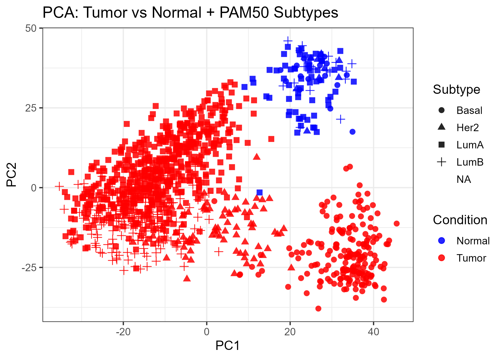

# TCGA-BRCA Pipeline: Subtype-Specific Surface Antigen Prioritisation

An R workflow that takes TCGA-BRCA bulk RNA-seq data through PAM50 subtyping, subtype-specific differential expression (DESeq2), surfaceome filtering, external GEO validation and co-expression analysis, to shortlist candidate surface antigens for dual-CAR NK-cell design.

> **Status: early build (v0), kept for transparency.** This repository contains the first version of the transcriptomic part (Phase I) of my M.Tech thesis, *Design and Optimization of Dual CAR-NK Cells for Breast Cancer Therapy Using AI/ML Approaches* (IIT Guwahati, 2026; supervisors Prof. Bithiah Grace Jaganathan and Dr. Suresh Sundaram). The final thesis pipeline is more refined and is **not published here**, because the work is being prepared for possible publication. This early build produced **false positives** (see the caveat below), so its outputs must not be read as a target list. Everything is computational prioritisation, **not experimentally validated**.

## What this early build produces

Differential expression of tumour versus normal tissue within each PAM50 subtype (DESeq2, Wald test, `ashr` shrinkage, adjusted p < 0.05 and |log2FC| ≥ 1). Counts come from `results/04_DESeq2_filtered/DEGs_*.csv`:

| Subtype | Upregulated | Downregulated |
| --- | ---: | ---: |
| Basal | 3,218 | 2,138 |
| Her2 | 2,819 | 2,550 |
| LumA | 2,196 | 2,088 |
| LumB | 2,595 | 2,666 |

### Known issue: false positives in the co-expression output

The highest-correlated gene pairs in `results/08_pairs/*_top_pairs.csv` are dominated by **immune and endothelial genes**, for example CD2–CD48 (Pearson r = 0.93 in Basal), CD2–IL2RG (0.95 in Her2), and PTPRB–TEK and ESAM–ROBO4 (about 0.91 to 0.92 in LumA). In bulk tissue these correlations mostly reflect infiltrating lymphocytes and blood vessels, not two antigens on the same tumour cell. These pairs are **not** dual-CAR targets. This early build has no normal-tissue safety filter or tumour-cell specificity check; later versions add them.

## Data

| File | Description |
| --- | --- |
| `TCGA_BRCA_count_matrix.csv` | Full GDC STAR gene-count matrix used for every analysis (84 MB; 16,837 genes × 1,231 samples plus 3 annotation columns). SHA-256 `81c0758e32c41cce38f1268bd6bece8c0ec9221adcde86e866ca92cce33c0189` |
| `gdc-client.exe` | GDC Data Transfer Tool (Windows build, 12 MB), kept so the download step can be reproduced with the same client. SHA-256 `b9d9362da6b98645c93e7832bf7029ff5fd88bc76ce2c2baa9d0f98e70574cb8` |

**Samples.** 1,231 samples were downloaded: 1,111 primary tumour (code 01), 113 solid tissue normal (11) and 7 metastatic (06). The 7 metastatic samples were excluded because the group is too small, breast cancer is a localised disease, and the DESeq2 design compares two groups (normal versus condition), so a third group cannot be added. **1,224 samples were analysed** (1,111 tumour + 113 normal; see `results/02_metadata/TCGA_BRCA_metadata_final.csv`).

To reproduce from scratch, rather than using the bundled matrix, use `gdc-client.exe` (or a current client from the [GDC](https://gdc.cancer.gov/access-data/gdc-data-transfer-tool)) to download the open-access TCGA-BRCA *STAR - Counts* files, then rebuild the matrix with `Script.rmd`. The checksums above let you confirm you have the exact files used here.

External resources: Human Protein Atlas v24.1 (subcellular location; CC BY-SA) for the surfaceome filter, and GEO series GSE86374 (used for LumA, LumB and Basal) and GSE29431 (Her2) for validation.

## Pipeline

1. **Preprocessing and metadata** (`Script.rmd`): build the count matrix, attach sample type and clinical metadata, QC and PCA.
2. **PAM50 subtyping** (`Subtypes_code.rmd`): assign Basal, Her2, LumA and LumB with `genefu`.
3. **Differential expression**: DESeq2 per subtype, tumour versus normal, then filtering at padj < 0.05 and |log2FC| ≥ 1 (`results/03_DESeq2_raw`, `results/04_DESeq2_filtered`).
4. **Surfaceome filtering** with HPA v24.1 (`results/06_surfaceome`, `results/HPA_intersected`).
5. **External validation** against the GEO series above (`results/GEO2R`, `results/Venn diagrams`).
6. **Co-expression** of surface DEGs, keeping pairs with |r| ≥ 0.7 (`results/07_coexpression`, `results/08_pairs`).

## Running it

Run the notebooks from the repository root (the folder containing `Script.rmd`) with **R 4.5.1** and Bioconductor installed; the first chunk installs the required packages. Run `Script.rmd` first, then `Subtypes_code.rmd`.

## Limitations

- Bulk RNA-seq cannot show which cell type expresses a gene, so tumour, immune and stromal signals are mixed (see the caveat above).
- Normal tissue here is TCGA tumour-adjacent tissue, not healthy-donor tissue.
- Surface annotation relies on HPA subcellular location only.
- Co-expression in bulk data is not evidence of co-expression on the same cell.
- No experimental validation has been done.

## Licence

Code is released under the [MIT licence](LICENSE). TCGA, HPA and GEO data remain under their own terms of use.
